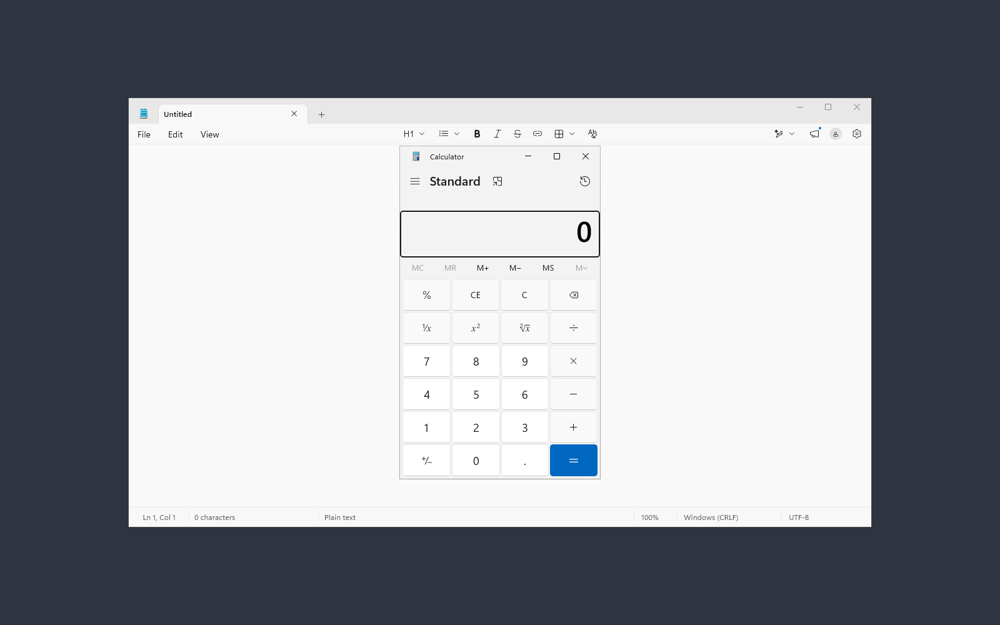
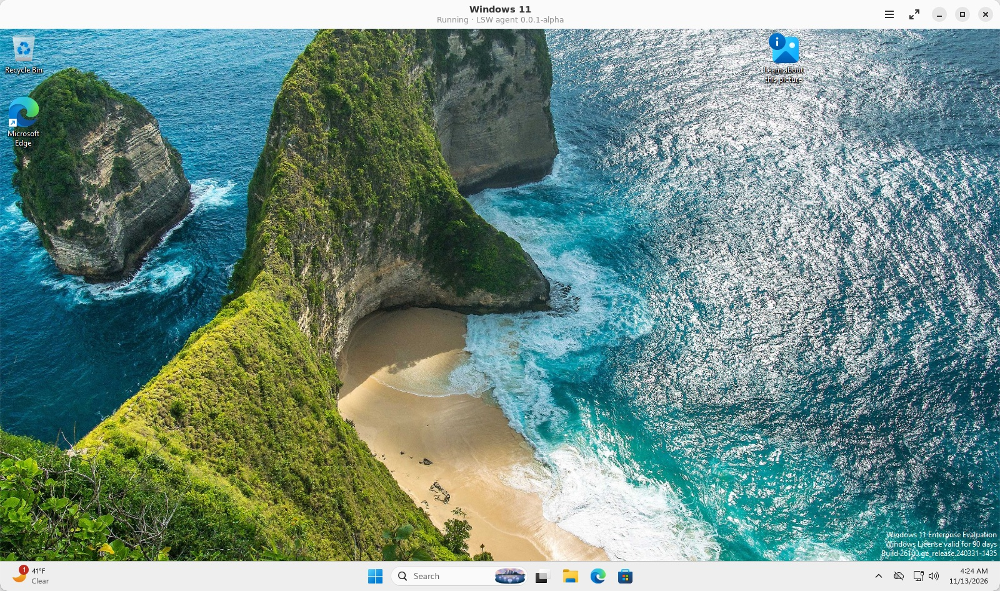

# LSW — Linux Subsystem for Windows

Windows 11 apps on your Linux desktop, as native windows.

LSW runs Windows 11 in a KVM virtual machine and shows each Windows app as its
own Linux window, with its own launcher in the app grid and its own entry in
the dock and Alt+Tab. You can also see the whole Windows desktop in a window
or full screen. It is the experience of Parallels Desktop's Coherence mode,
built for Linux (Ubuntu and CachyOS first) from open-source parts.

> **Status: 0.0.1-alpha.** For testing, not for your daily work. See
> [what works](#what-works-in-this-alpha) and the
> [known limits](#known-limits).



*Coherence: Windows 11's Notepad and Calculator as two native windows on a
Linux desktop. Clicking in them works as in Windows
([7 + 2 = 9](docs/images/coherence-input-calculator.png)), and any Windows
app starts from the Linux app grid ([Paint](docs/images/coherence-launch-paint.png)).*

## What works in this alpha

| Feature | Notes |
|---|---|
| Unattended install | Downloads Windows 11 from Microsoft (refused unless it matches the SHA-256 Microsoft publishes), the 90-day Enterprise Evaluation (HTTPS from Microsoft; Microsoft publishes no checksum for it) or uses your ISO. Secure Boot with Microsoft's keys, TPM 2.0, no hardware-requirement bypasses. About 20 minutes. |
| Coherence | Each Windows window is a native Wayland window; Windows draws its own title bar. Title-bar drags and edge drags are native moves and resizes. |
| Windows apps in the app grid | One launcher per installed Windows app (Store and desktop), with its icon, grouped in a "Windows Apps" folder on GNOME. Clicking one starts Windows if needed. |
| Window and Full Screen views | The whole Windows desktop in the LSW app; Windows follows the window size, and Full Screen runs at the monitor's native resolution. |
| Shared folders | Linux Desktop, Documents, Downloads, Pictures, Music and Videos are the same folders in Windows (virtiofs, sandboxed). |
| Clipboard | Text, HTML and images, both ways, in the Window and Full Screen views. |
| Sound | Windows plays through PipeWire. The microphone is off in this alpha. |
| USB | Plug a USB device into Windows and back (`lsw usb`). |
| Idle | With nothing of Windows on screen for a minute, the VM pauses (0 % CPU) and resumes when you need it. |
| Updates of the in-guest agent | Automatic, from the LSW Tools CD that every boot attaches. |

## Known limits

* **3D acceleration (GPU tier A) is not in this release.** Its Windows driver
  is still being developed; LSW never turns Secure Boot off or enables test
  signing without it. Windows gets a 2D display (tier D).
* GPU passthrough (tier B, a second GPU; tier C, Intel SR-IOV) is
  experimental: implemented on the Linux side (`lsw gpu`) but not tested on
  real hardware. You must raise the locked-memory limit yourself, and an
  assignment does not survive a host restart.
* The clipboard is not shared while you use Coherence (it is in the Window
  and Full Screen views).
* Secure Boot needs UEFI firmware with Microsoft's keys enrolled. Ubuntu's
  `ovmf` has it; Arch's `edk2-ovmf` does not, so on CachyOS/Arch `lsw create`
  stops and explains (`--no-secure-boot` creates the VM with Secure Boot off).
* Not yet: Windows tray icons and notifications on the Linux desktop,
  opening links in the Linux browser, file associations, drag and drop,
  saving the VM to disk when idle (shared folders block QEMU 8.2's state
  saving), and a graphical setup wizard (use `lsw create`).
* Coherence frames travel over virtio-serial with compression rather than
  shared memory (no signed IVSHMEM driver exists for current Windows 11);
  fine for apps and documents, not for video or games.
* Wayland desktops only; tested with GNOME on Ubuntu 24.04 and sway.

## Requirements

* x86-64 CPU with VT-x or AMD-V, KVM (`/dev/kvm`), 16 GB RAM, 64 GB free disk.
* Ubuntu 24.04+ or CachyOS/Arch, Wayland session.
* A Windows 11 licence (the installer can use the 90-day Enterprise
  Evaluation for testing).

## Install

Ubuntu 24.04 or later on x86-64 (amd64): download `lsw_0.0.1.alpha.1_amd64.deb` from the
[releases page](https://github.com/The1UNeed/Linux-Subsystem-for-Windows/releases),
then, in the folder you saved it to, install it with apt:

```sh
sudo apt install ./lsw_0.0.1.alpha.1_amd64.deb
```

apt also installs QEMU, swtpm and the other packages LSW needs. There is no
PPA yet. `sudo apt install lsw` without the `.deb` installs a different
program: Ubuntu's `suckless-tools`, which includes dmenu and an X11 tool also
called `lsw`. LSW installs beside it and renames that tool to
`lsw.suckless-tools`. Removing LSW gives the name back.

CachyOS / Arch: build `packaging/arch/PKGBUILD` with `makepkg -si`.

From source: see [docs/BUILDING.md](docs/BUILDING.md).

## First run

```sh
lsw doctor                 # checks your machine; fixes are listed
lsw create                 # downloads Windows 11 and prepares the VM
lsw install                # installs Windows unattended (~20 min)
systemctl --user enable --now lsw@windows   # keep the VM supervised
```

Then open **Windows** from the app grid for the full desktop, or any Windows
app from the "Windows Apps" folder.



*The Window view: Windows resizes to fit the window.*

More in the [user guide](docs/USER-GUIDE.md).

## How it works

Linux is the host, Windows 11 is a KVM guest driven directly through QEMU's
QMP. A small Rust agent inside Windows tracks and captures windows
(Windows.Graphics.Capture), mounts the shared folders and bridges the
clipboard; the Linux side mirrors each window as a Wayland surface. The guest
is treated as untrusted: every message is size-checked and validated. The
design, including every decision changed during implementation and why, is
in [docs/DESIGN.md](docs/DESIGN.md).

## Licence

Apache-2.0. LSW starts, but does not link, GPL components (QEMU, swtpm,
virtiofsd, passt). Inside Windows it installs the signed virtio-win drivers
(BSD-3-Clause) and WinFsp (GPLv3 with FLOSS exception), both downloaded from
their upstream releases and verified by SHA-256.
